<p align="center">
  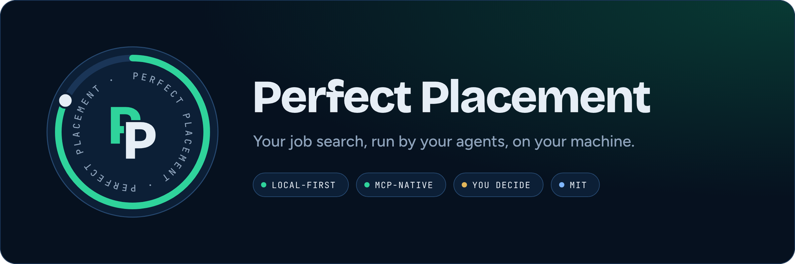
</p>

<p align="center">
  <a href="LICENSE"></a>
  <a href="https://github.com/askoulwassim/perfect-placement/actions/workflows/ci.yml"></a>
  
  
  
</p>

<p align="center">
  <b><a href="#quickstart">Quickstart</a> · <a href="#how-it-works">How it works</a> · <a href="#the-loop">The loop</a> · <a href="#screens">Screens</a> · <a href="#docs">Docs</a> · <a href="CONTRIBUTING.md">Contribute</a></b>
</p>

<p align="center">
  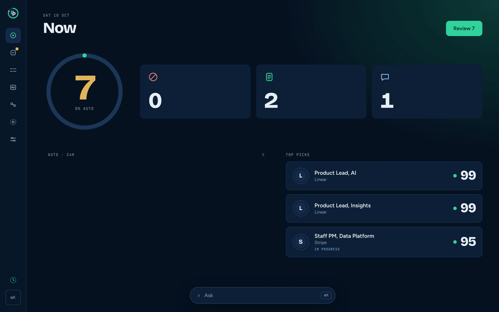
</p>

Perfect Placement finds roles that fit you, scores them against a profile it keeps learning, checks that postings are still open, tailors your applications, finds people who can open doors, and watches your inbox. It runs on your machine, works from the AI agent you already use, and never submits or sends anything without you.

| **Local-first** | **Bring your own agent** | **You decide** | **One ops registry** |
| :-- | :-- | :-- | :-- |
| Your data stays in `~/.perfect-placement` on your machine. | One MCP server for Claude Code, Codex, Cursor and Claude Desktop. No API keys. | Confidence × impact decides what runs on its own. Submitting and sending are always you. | Anything you can click, your agent can do, and the other way round. |

## Quickstart

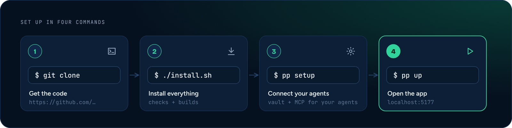

```sh
git clone https://github.com/askoulwassim/perfect-placement.git && cd perfect-placement
./install.sh
pp setup
pp up
```

Then open **http://127.0.0.1:5177**. The first screen walks you through your profile.

- **You need** macOS or Linux, Node 22+ and git (on macOS, also the Xcode Command Line Tools). `./install.sh --check` tells you what's missing and changes nothing.
- **Just looking?** `pp up --fixtures` runs the whole app on demo data.
- **More detail and troubleshooting:** [docs/install.md](docs/install.md). Removing it: [docs/uninstall.md](docs/uninstall.md).

## How it works

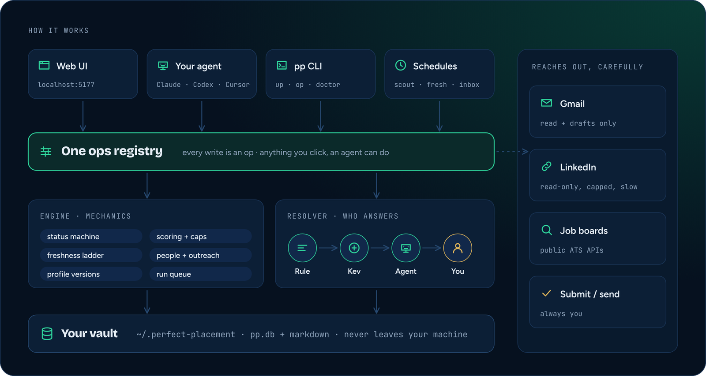

Every surface calls the same ops, so the app, your agent and scheduled runs always agree. Your agent supplies judgment (search, scores, drafts); code does the mechanics (totals, moves, dedupe, logs). [Architecture](docs/architecture.md)

## The loop

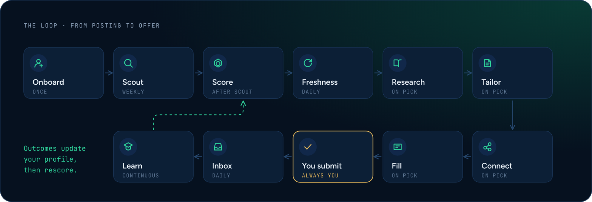

Each stage is a skill your agent runs, written as a plain `SKILL.md` that Claude Code, Codex and Cursor can all follow:

| Skill | What it does |
| :-- | :-- |
| [`onboard`](skills/onboard/SKILL.md) | Builds your profile from your resume, a short interview and 12 sample roles |
| [`scout`](skills/scout/SKILL.md) | Finds new roles on your watchlist companies and the open market |
| [`score`](skills/score/SKILL.md) | Scores each role on nine criteria, with company names hidden where it matters |
| [`freshness`](skills/freshness/SKILL.md) | Checks daily that postings are still open |
| [`research`](skills/research/SKILL.md) | Writes a company dossier for a role you pick |
| [`tailor`](skills/tailor/SKILL.md) | Tailors your resume, cover letter and fit map |
| [`connect`](skills/connect/SKILL.md) | Finds people who can open doors and drafts the outreach |
| [`fill`](skills/fill/SKILL.md) | Answers the portal's real questions and stops before Submit |
| [`inbox`](skills/inbox/SKILL.md) | Reads replies and moves roles along: applied, interviews, offers |
| [`learn`](skills/learn/SKILL.md) | Turns outcomes into profile updates, with evidence |
| [`voice`](skills/voice/SKILL.md) | Learns how you write, so drafts sound like you |

## Who decides

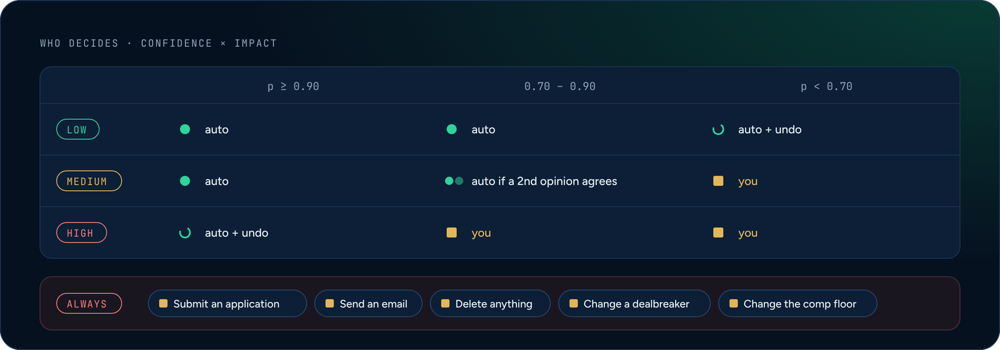

Every judgment goes to the cheapest source that can answer it: a rule, then **Kev** (a small local model), then your agent, then you. You never get a blank question, only the pick and how sure it is. Thresholds live in Settings.

## Screens

<table>
  <tr>
    <td width="50%">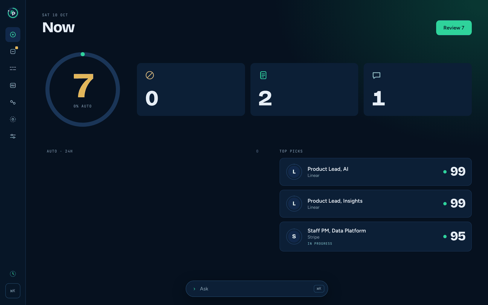<p align="center"><b>Now</b>: what needs you and your top picks</p></td>
    <td width="50%">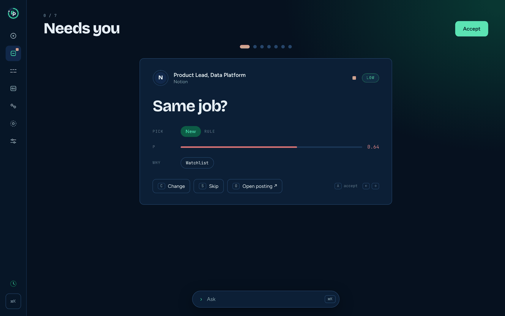<p align="center"><b>Needs you</b>: one decision at a time, pick shown</p></td>
  </tr>
  <tr>
    <td>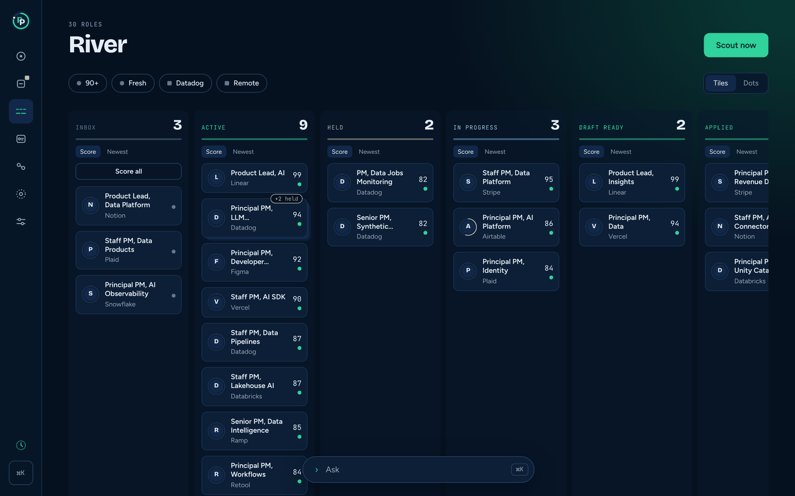<p align="center"><b>River</b>: every role, from inbox to offer</p></td>
    <td>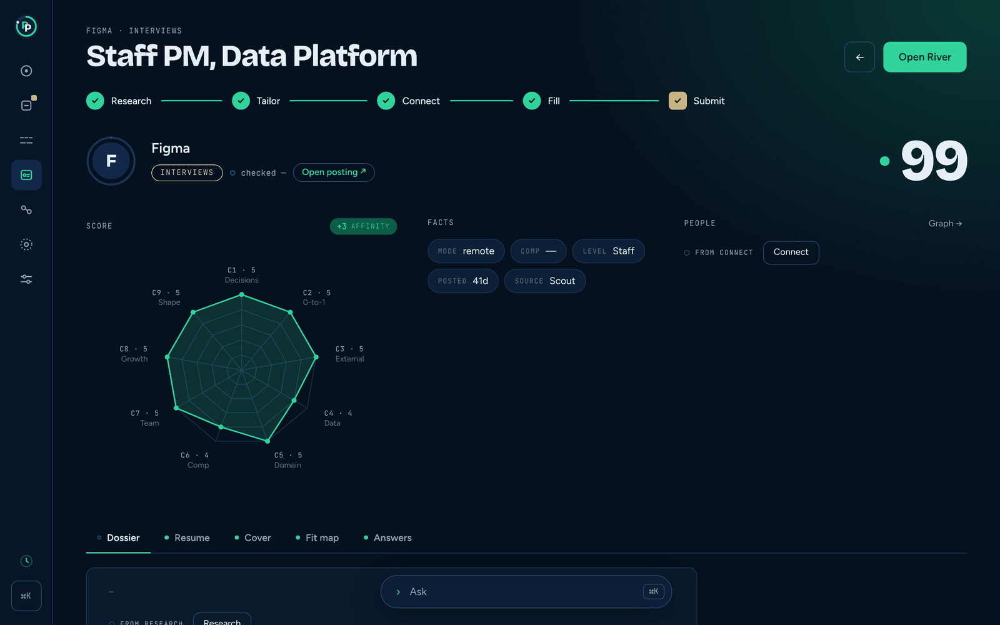<p align="center"><b>Role</b>: score, facts and your application</p></td>
  </tr>
  <tr>
    <td>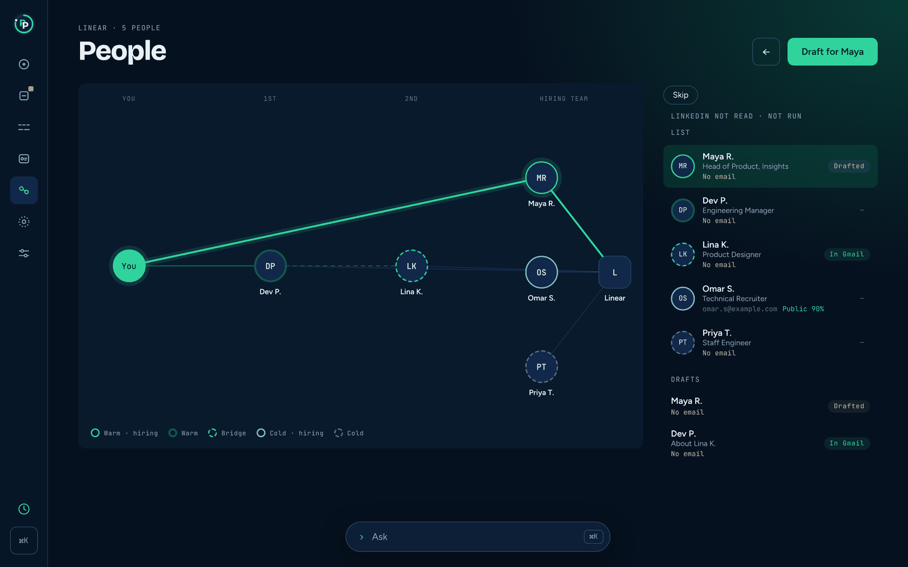<p align="center"><b>People</b>: the best path to the hiring team</p></td>
    <td>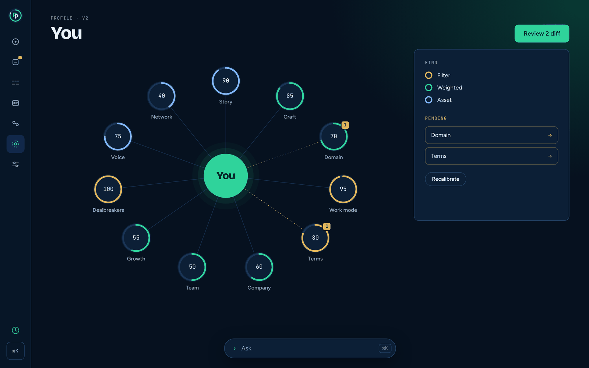<p align="center"><b>You</b>: your profile, in 11 parts</p></td>
  </tr>
</table>

## Privacy and responsible use

- Everything lives in your vault, `~/.perfect-placement` (SQLite plus markdown). The server listens on `127.0.0.1` only. New vaults are readable only by your account.
- pp never submits an application or sends an email or message. It drafts; you review and send.
- The connect skill reads LinkedIn pages in your own signed-in browser, slowly and within daily caps. Follow LinkedIn's terms and keep it to your own search.
- You are responsible for what you send. Security reports: [SECURITY.md](SECURITY.md).

## Docs

Everything in this repo, and where to find it.

| Start here | |
| :-- | :-- |
| [docs/install.md](docs/install.md) | Install, setup, troubleshooting, Kev, documents, email check, schedules |
| [docs/uninstall.md](docs/uninstall.md) | Undo setup, or remove everything (with a backup first) |
| [AGENTS.md](AGENTS.md) | The operating manual for coding agents working on this repo |
| [CONTRIBUTING.md](CONTRIBUTING.md) | Dev setup, ground rules, sign-off |

| How it's designed | |
| :-- | :-- |
| [docs/architecture.md](docs/architecture.md) | Layers, flow, profile model, scoring, freshness, connect |
| [docs/decisions.md](docs/decisions.md) · [docs/wave1-decisions.md](docs/wave1-decisions.md) | Why it works the way it does (cited in code as `#N`) |
| [docs/design.md](docs/design.md) | UI tokens, components, screens and rules |
| [docs/history/contract-changes.md](docs/history/contract-changes.md) | The build-era log of contract changes |

| Packages | |
| :-- | :-- |
| [packages/contracts](packages/contracts) | Schemas, statuses, events, the ops registry, policy, design tokens |
| [packages/engine](packages/engine) | The mechanics: [db](packages/engine/db/README.md) · [ops](packages/engine/ops/README.md) · [status](packages/engine/status/README.md) · [scoring](packages/engine/scoring/README.md) · [freshness](packages/engine/freshness/README.md) · [people](packages/engine/people/README.md) · [profile](packages/engine/profile/README.md) · [ATS](packages/engine/integrations/ats/README.md) · [Gmail](packages/engine/integrations/gmail/README.md) · [LinkedIn](packages/engine/integrations/linkedin/README.md) |
| [packages/resolver](packages/resolver/README.md) | Who decides: rule, Kev, agent, you · [Kev setup](packages/resolver/docs/kev-setup.md) · [eval report](packages/resolver/eval-reports/synthetic/report.md) |
| [packages/mcp](packages/mcp/README.md) | The MCP server, with config snippets for each agent |
| [packages/cli](packages/cli/README.md) | The `pp` command |
| [apps/web](apps/web/README.md) | The web app · [Ask replies (OpenUI)](apps/web/genui/README.md) |
| [packages/fixtures](packages/fixtures) | The synthetic demo vault behind `pp up --fixtures` and the tests |

| Skills and project | |
| :-- | :-- |
| [skills/](skills) | One `SKILL.md` per stage (table above), plus the [connect runbook](skills/connect/RUNBOOK.md), [onboarding extraction](skills/onboard/extract.md) and [scout plan](skills/scout/plan.md) |
| [CHANGELOG.md](CHANGELOG.md) · [SECURITY.md](SECURITY.md) · [CODE_OF_CONDUCT.md](CODE_OF_CONDUCT.md) · [THIRD_PARTY_NOTICES.md](THIRD_PARTY_NOTICES.md) | Changes, security, conduct, notices |

## Develop

```sh
corepack enable
pnpm i && pnpm build && pnpm test && pnpm lint
pp up --fixtures
```

Contributions are welcome: read [CONTRIBUTING.md](CONTRIBUTING.md) and sign off your commits (`git commit -s`).

## License

[MIT](LICENSE). The license covers the code; it grants no rights to the Perfect Placement name or logo.
